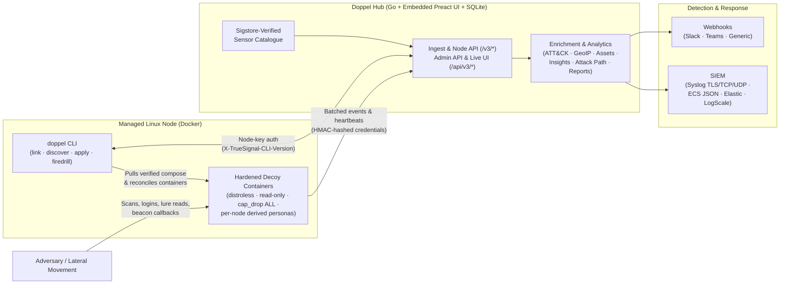

# Doppel

**Doppel is a self-hosted, supply-chain-verified deception platform for Linux and cloud infrastructure.** It deploys hardened, protocol-accurate decoy containers, honeytoken lures, and DNS/HTTP beacons across your fleet, catching lateral movement with near-zero false positives and mapping every hit to MITRE ATT&CK and your SIEM.

---

## Architecture



### Security & Anti-Fingerprinting Highlights

- **Supply-chain verified:** Sensor manifests are Sigstore-signed (OIDC + Rekor + SCT) and container images are pinned by SHA-256 digest.
- **Hardened runtime:** Every decoy runs in a distroless image with `read_only: true`, `no-new-privileges`, `cap_drop: ALL` (plus at most one declared capability when binding ports `< 1024` or raw sockets), and strict memory/PID limits.
- **Per-node anti-fingerprinting personas:** SSH Ed25519 host keys, NTLM domain/host identities, and SNMPv3 engine IDs are derived deterministically per node via `HMAC-SHA256(TS_CAPTURE_KEY, purpose)`, so no two nodes share identical fingerprints.
- **Privacy-preserving credential capture:** Passwords and NTLM/community secrets are HMAC-SHA256 hashed by default (`TS_PASSWORD_CAPTURE=hash`) using a per-node capture key—enabling honeytoken matching without storing cleartext credentials.
- **Auto-blend discovery:** `doppel discover --plan --apply` inspects host services and open ports to propose and deploy a conflict-free decoy mix.

---

## Sensor Matrix (10 Production Sensors)

| Sensor | Protocols / Surface | Key Triggers | MITRE ATT&CK Coverage | Default Privileges |
|---|---|---|---|---|
| `remote-access-decoy` | SSH 2.0, Telnet (RFC 854/1572), FTP (RFC 959) | `ssh_login`, `telnet_login`, `ftp_login` | `T1110` Brute Force, `T1021.004` SSH, `T1078` Valid Accounts | `NET_BIND_SERVICE` |
| `database-decoy` | MySQL/MariaDB, PostgreSQL v3, MS SQL Server (MS-TDS 7.x) | `mysql_login`, `postgres_login`, `mssql_login` | `T1110` Brute Force, `T1078` Valid Accounts, `T1046` Network Service Discovery | nonroot (`65532`) |
| `identity-decoy` | LDAP, LDAPS, RDP (X.224 + TLS + CredSSP/NTLM) | `ldap_login`, `ldaps_login`, `ldap_query`, `rdp_login` | `T1087.002` Domain Account Discovery, `T1021.001` RDP, `T1110` Brute Force | `NET_BIND_SERVICE` |
| `network-service-decoy` | SNMP v1/v2c/v3 (BER), log-only DNS (UDP/TCP, anti-amplification) | `snmp_query`, `dns_query` | `T1046` Network Service Discovery, `T1590.002` DNS Recon | `NET_BIND_SERVICE` |
| `web-router-decoy` | HTTP admin portals (`router`, `nas`, `vpn`, `webmail`, `admin`, `basic`) | `web_login_attempt`, `web_path_probe`, `web_page_view` | `T1190` Exploit Public-Facing App, `T1110` Brute Force | nonroot (`65532`) |
| `file-canary` | Lure files (`.env`, `.pgpass`, SQL dumps, VPN keys) via `inotify` | `decoy_file_accessed`, `decoy_file_tampered` | `T1552.001` Credentials in Files, `T1083` File Discovery | `DAC_OVERRIDE` (read-only mount) |
| `token-receiver` | Authoritative DNS + 1×1 HTTP web-bug beacon receiver | `beacon_triggered`, `receiver_saturated` | `T1071` Application Layer Protocol, `T1552` Unsecured Credentials | `NET_BIND_SERVICE` |
| `tcp-tarpit` | Configurable TCP ports (`hold`, `echo`, `close` modes) | `tcp_connection`, `tcp_session_payload` | `T1046` Network Service Discovery | `NET_BIND_SERVICE` |
| `network-scan-detector` | Passive `AF_PACKET` SYN/FIN/NULL/XMAS/UDP scan detection | `network_scan_detected` | `T1046` Network Service Discovery | `NET_RAW` |
| `icmp-canary` | Passive ICMPv4/ICMPv6 echo, timestamp, and mask requests | `icmp_scan_received` | `T1018` Remote System Discovery | `NET_RAW` |

All sensors also support Hub-raised `honeytoken_used` (critical) correlation whenever a planted `file-canary` credential is replayed against any login decoy. See [`docs/sensors.md`](docs/sensors.md) and [`docs/siem/attack-mapping.md`](docs/siem/attack-mapping.md) for full details.

---

## 60-Second Local Demo

Experience a full attacker kill-chain end-to-end on your machine (port scan → SSH brute-force → PostgreSQL login → web router login → lure file theft & honeytoken reuse → DNS/HTTP beacon callbacks) with no root privileges or external infrastructure required:

```sh
./scripts/demo/run-demo.sh
```

The script builds the Hub and UI, starts a local Hub on `http://127.0.0.1:18080`, deploys 6 decoys on high non-privileged ports, runs the scripted kill-chain, and leaves the Hub running with a populated **Dashboard**, **ATT&CK Matrix**, **Geo Map**, **Attack Path**, **Scans**, and **Executive Report**.

To run in automated verification mode (verifies all expected events and exits):

```sh
./scripts/demo/run-demo.sh --smoke
```

Prerequisites for the demo script: `go` (1.27.4+), `node` (22+, or pass `--skip-ui-build`), `python3`, `curl`, and `jq`.

---

## 5-Minute Production Quickstart

1. **Start the Hub** using the hardened production compose file in [`deploy/`](deploy/) (see [`docs/operations.md`](docs/operations.md) for KEK provisioning and reverse-proxy TLS termination):
   ```sh
   docker compose -f deploy/docker-compose.yml up -d
   ```
   Retrieve the one-time setup token from the Hub logs, open the Hub UI, set the admin password (and enroll TOTP MFA), and configure your Hub `public_endpoint` in **Settings**.

2. **Create a node** in the Hub UI (**Fleet → Create node**). Copy the one-time `TS_NODE_KEY` and link command.

3. **Install the `doppel` CLI and link the host** (as root on a Linux node with Docker):
   ```sh
   TS_NODE_KEY='tsk_...' doppel link https://hub.example.com
   ```

4. **Auto-blend decoys onto the host** (inspects running services/ports and proposes conflict-free decoys):
   ```sh
   doppel discover --plan
   doppel discover --apply
   ```
   Or add and configure sensors directly from **Fleet** in the Hub UI, then run `doppel apply` (or wait for the systemd timer).

5. **Verify end-to-end telemetry** with a synthetic fire drill:
   ```sh
   doppel firedrill
   ```

---

## Repository Layout

| Path | Description |
|---|---|
| `hub/` | Go Hub server (`truesignal-hub`), SQLite store, compose compiler, Sigstore verifier, enrichment, projections, SIEM/webhook outputs |
| `ui/` | Embedded Preact + TypeScript admin UI (strict CSP: zero inline scripts or styles) |
| `cli/` | `doppel` node agent CLI (`link`, `discover`, `apply`, `status`, `firedrill`, `uninstall`) and verified installer |
| `sensors/` | 10 production decoy sensors + `sensors/template` reference sensor |
| `sdk/go`, `sdk/python` | Go (`sensor`, `decoy`, `ber`) and stdlib-only Python (`doppel_sdk`) Sensor SDKs (contract v3) |
| `deploy/` | Hardened production Hub Docker Compose bundle |
| `scripts/demo/` | 60-second realistic kill-chain demo simulator (`run-demo.sh`) |
| `docs/` | API (`openapi.yaml`), contract v3, manifest schema v3, SIEM rules (Elastic & LogScale), operations guide, and threat model (`THREATMODEL.md`) |

Governance & provenance records: [`PROVENANCE.md`](PROVENANCE.md), [`QUESTIONS.md`](QUESTIONS.md), [`THIRD_PARTY.md`](THIRD_PARTY.md).

---

## Development & Verification

Requires Go 1.27.4+ and Node 22+.

```sh
make                              # check-headers, gofmt, go vet, go test -race across all go.work modules
make ui                           # UI: npm ci, tsc --noEmit, CSP/safety lint, build
make hub-bin                      # Build UI + Hub binary with embedded UI -> bin/truesignal-hub
python3 scripts/validate-docs.py  # Validate all sensor manifests (JSON schema) + OpenAPI/route parity
./scripts/compose-guard.sh        # Verify production compose hardening invariants
./scripts/release/selftest.sh     # Run release guard self-tests
```

A Hub built without `make ui` runs normally and serves a placeholder page instead of the UI.

---

## Scope, Known Limits & Roadmap

### Current Scope & Limits
- **Single-node Hub database:** The Hub uses embedded SQLite (WAL mode) with application-layer AEAD sealing for secrets. Multi-replica HA Hub deployments are not yet supported.
- **Linux / Docker nodes:** Managed nodes require Linux with Docker Engine and Compose v2.
- **TLS termination:** Production deployments currently terminate HTTPS at a reverse proxy (`TS_TRUSTED_PROXIES`); native Hub TLS is next on the roadmap.
- **`file-canary` attribution:** Uses Linux `inotify`, which reports `source: "local"` without PID/process attribution (correlate with EDR/auditd until eBPF lands).

### Planned Roadmap
- **Enterprise Pilot Hardening:** Native Hub HTTPS with `SIGHUP` cert reload, `/healthz` / `/readyz` / Prometheus `/metrics`, OIDC SSO with group-to-role mapping, and offline `backup` / `restore` CLI commands.
- **eBPF-backed `file-canary`:** Capture exact PID, UID, binary path, and parent process tree on lure access.
- **Windows / Active Directory & Cloud Decoys:** Windows endpoint lures/SMB decoys, cloud IAM honeytokens, and Kubernetes decoy sidecars.
- **High-Availability Hub:** Optional PostgreSQL backend behind `hub/internal/store`.
