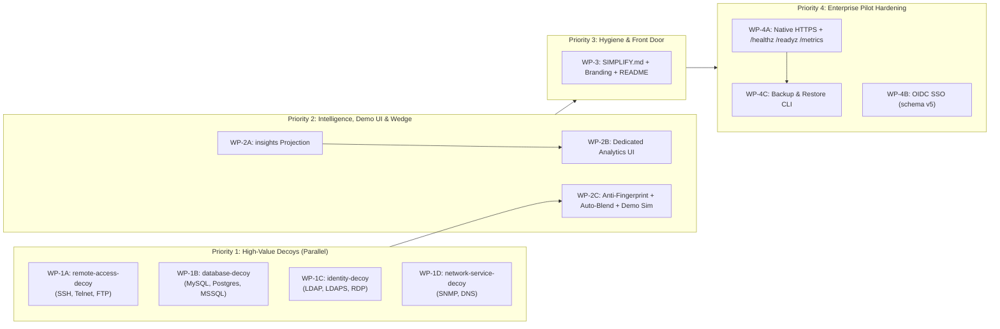

# Doppel — Master Product & Engineering Execution Plan

**Target Repository:** `mahmoudahmed3132/Doppel` (Go 1.27.3, Preact + TypeScript, SQLite, Docker Compose)  
**Intended Executor:** Gemini Neon (autonomous coding agent)  
**Objective:** Close all product, deception, UI, and engineering gaps in Doppel—prioritized for **maximum startup/accelerator demo impact first**, followed by **codebase hygiene** and **enterprise pilot readiness**.

---

## 0. Mandatory Execution Rules (Read Before Writing Any Code)

Every work package (WP) in this plan MUST follow these repository invariants:

1. **Branching & Commits:** Branch from `main` using the branch name specified in each WP. Do not tag, publish, or force-push. One logical commit per sub-milestone.
2. **Reuse Existing Foundations (Do NOT Reinvent):**
   - `sdk/go/sensor` — `sensor.Main`, settings, heartbeats, fire drill, graceful shutdown, `sensor.SourceLimiter`, `sensor.Clean`.
   - `sdk/go/decoy` — `Accept`, `ServePacket` (UDP), `NewCapture` / `Capture.Password` / `Capture.Secret` (`TS_PASSWORD_CAPTURE` + `TS_CAPTURE_KEY`), `Limiter`, `RemoteIP`, `Sanitize`.
   - `sdk/go/ber` — strict definite-length BER reader and writer (already fuzzed). **Never hand-roll BER** for LDAP or SNMP.
   - Manifest v3 `runtime.listen_ports[].enabled_key` — bind every optional protocol port to its boolean enable flag so disabled protocols do not hold ports.
3. **Clean-Room & Licensing Hygiene:**
   - Every new source file must begin with the repo license header verified by `scripts/check-headers.sh`.
   - Use **only** standard library, public RFCs/MS-* specs, and permissive third-party dependencies (MIT, BSD, Apache-2.0, ISC). Record every new dependency in `THIRD_PARTY.md`.
   - Add one row per new sensor/feature in `PROVENANCE.md` (`clean implementation from spec; public standards only`).
   - Record any non-obvious design decision or ambiguity in `QUESTIONS.md` with the conservative default.
4. **Dockerfile & Runtime Hardening Standard (All New Sensors):**
   - Copy the exact pinned base images from `sensors/tcp-tarpit/Dockerfile`:
     - Build: `golang:1.27.3-bookworm@sha256:d9b6a1beb9474adc2a1ce842573639b44b2a0dd49b6669f51d3821baf9ec37c9`
     - Runtime: `gcr.io/distroless/static-debian12:nonroot@sha256:afa5c872c891853ca7fcf1f12c3edb23f7eeef36189728842dd51042ff57f7ab`
   - Build flags: `CGO_ENABLED=0 GOFLAGS=-trimpath GOWORK=off`, `-ldflags='-s -w -buildid='`.
   - Manifest runtime: `network_mode: "host"`, `user: "0:0"` + `cap_add: ["NET_BIND_SERVICE"]` when default ports `< 1024` (or `65532:65532` with no caps if all ports `>= 1024`), `memory_mb: 128`, `image.repository: "ghcr.io/mahmoudahmed3132/ts-sensor-<name>"`, `version: "1.0.0"`.
   - Register every new Go module in `go.work`, `docs/sensors.md`, and `README.md`.
5. **Strict UI Security Rules:**
   - Preact + TypeScript, strict CSP (`default-src 'self'`, **zero** inline `<script>`, **zero** inline `style="..."`, no `dangerouslySetInnerHTML`, no `innerHTML`, no `eval`). All styling via CSS classes in `ui/src/styles.css`.
   - Must pass `cd ui && npm run check`.
6. **Mandatory Verification Gates (Run & Report After Every WP):**
   ```sh
   make                              # check-headers, gofmt, go vet, go test -race across all go.work modules
   make ui                           # UI type-check, safety lint, CSP build (whenever ui/ changes)
   python3 scripts/validate-docs.py  # manifest JSON schema + OpenAPI/routes drift
   ./scripts/compose-guard.sh        # compose hardening guard
   ./scripts/release/selftest.sh     # release guard tests
   ```
   Also run `go test -fuzz=. -fuzztime=15s ./...` on every new protocol parser.

---

## 1. Prioritized Roadmap & Dependency Graph



**Why this order?**
- **P1 + P2** transform Doppel from a hardened control plane with 6 basic sensors into a **complete, demo-ready deception platform** that catches real lateral movement (SSH, DBs, AD/LDAP/RDP, SNMP/DNS) and visualizes the attacker kill-chain in a polished UI.
- **P3** eliminates AI-rewrite dead code, stale docs, and `TrueSignal` vs `Doppel` naming drift before external review.
- **P4** closes the remaining production/enterprise blockers (`H1`, `S1`, `B1`) ahead of paying pilots.

---

## 2. Priority 1 — High-Value Service Decoys

All four decoys follow `docs/clean-specs/common-decoy.md`. Shared invariants across all four:
- **Never grant access.** Every login fails with the exact wire-level error of a real server.
- **Bounded everything:** `SetDeadline` (e.g., 30 s read idle, 2 min total), global max connections (`TS_MAX_CONNS`, default 512), per-source max connections (`TS_MAX_PER_SOURCE`, default 16), per-source event limiter (`decoy.NewLimiter`), bounded packet/message lengths.
- **Evidence policy:** Always use `decoy.NewCapture(r)` (`TS_PASSWORD_CAPTURE` default `hash`, `TS_CAPTURE_KEY` Hub-injected). Never log or emit cleartext passwords unless `plain` is explicitly configured.
- **Fire drill:** Emit one synthetic `<protocol>_login` (or `<protocol>_query`) event with `username: "drill"`.
- **Triggers:** Use `<protocol>_login` (severity `high`) and `<protocol>_connection` (severity `medium`) so existing MITRE ATT&CK mappings and Elastic/LogScale SIEM rules trigger automatically.

---

### WP-1A: `remote-access-decoy` (SSH 2.0, Telnet, FTP)
**Branch:** `clean/remote-access-decoy`  
**Spec:** `docs/clean-specs/remote-access-decoy.md`  
**Module:** `sensors/remote-access-decoy`

#### File Layout
```
sensors/remote-access-decoy/
├── Dockerfile
├── go.mod                  # depends on sdk/go + golang.org/x/crypto/ssh
├── manifest.json           # schema v3, listen_ports with enabled_key
├── main.go                 # sensor.Main wiring, config parsing, conn limiter, fire drill
├── ssh.go                  # RFC 4251-4254 server + deterministic Ed25519 host key
├── telnet.go               # RFC 854/1572 IAC state machine + login prompt
├── ftp.go                  # RFC 959 command loop
├── decoy_test.go           # unit + E2E real-client tests (ssh.Dial, net.Pipe)
└── fuzz_test.go            # FuzzTelnet, FuzzFTP
```

#### Implementation Details
1. **Deterministic Host Key (Anti-Fingerprinting):**
   - Derive an Ed25519 seed deterministically via `HMAC-SHA256(TS_CAPTURE_KEY, "doppel:ssh-host-key:v1:" + sensorID)` and pass the 32-byte digest to `ed25519.NewKeyFromSeed`.
   - Result: stable host key across container restarts on the same node, unique per node/sensor, never written to disk.
2. **SSH (`ssh.go`):**
   - Use `golang.org/x/crypto/ssh.ServerConfig`:
     - `ServerVersion`: configurable (`TS_SSH_BANNER`, default `SSH-2.0-OpenSSH_9.6p1 Ubuntu-3ubuntu13.5`).
     - `MaxAuthTries`: configurable (default `6`).
     - `PasswordCallback`: capture `username`, `method: "password"`, `client_version`, `capture.Password(string(pass))`; emit `ssh_login` (severity `high`); always return `errors.New("permission denied")`.
     - `KeyboardInteractiveCallback`: prompt `"Password: "` (echo off), capture response with `capture.Password(...)`, emit `ssh_login` (`method: "keyboard-interactive"`), always reject.
     - `PublicKeyCallback`: emit `ssh_login` (`method: "publickey"`, `key_type: key.Type()`, `key_fingerprint: ssh.FingerprintSHA256(key)`), always reject.
     - If handshake succeeds or fails without any auth attempt, emit `ssh_connection` (severity `medium`) with `client_version`.
3. **Telnet (`telnet.go`):**
   - Implement a strict byte-by-byte IAC (`0xFF`) state machine:
     - Handle `WILL`/`WONT`/`DO`/`DONT` (refuse unknown options; optionally `WILL ECHO` + `WILL SGA` for realistic password masking).
     - Parse `SB NEW-ENVIRON` (RFC 1572, option `39`) to extract `USER` if sent.
     - Strip all IAC sequences and non-printable control bytes before reporting.
   - Send configurable banner (`TS_TELNET_BANNER`) + `login: ` → read line (max 256 bytes) → `Password: ` → read line (max 256 bytes) → sleep 400–800 ms → send `Login incorrect\r\n`. Allow up to 3 attempts, then close.
   - Emit `telnet_login` with `username` + `capture.Password(pass)`.
4. **FTP (`ftp.go`):**
   - Send `220 <TS_FTP_BANNER>\r\n` (default `220 (vsFTPd 3.0.5)`).
   - Read lines up to 512 bytes (close immediately if exceeded).
   - Commands:
     - `USER <arg>`: store pending username, reply `331 Please specify the password.\r\n`.
     - `PASS <arg>`: emit `ftp_login` with `username`, `anonymous: strings.EqualFold(user, "anonymous") || strings.EqualFold(user, "ftp")`, `capture.Password(arg)`; sleep 300–600 ms; reply `530 Login incorrect.\r\n`.
     - `AUTH TLS` / `AUTH SSL`: reply `534 Policy requires plain authentication.\r\n` (or optional TLS if enabled).
     - `SYST`: `215 UNIX Type: L8\r\n`; `FEAT`: `211-Features:\r\n211 End\r\n`; `QUIT`: `221 Goodbye.\r\n` and close.
     - Anything else: `530 Please login with USER and PASS.\r\n`.
5. **Manifest (`manifest.json`):**
   - Config keys: `TS_ENABLE_SSH` (`bool`, default `true`), `TS_SSH_PORT` (`port`, default `22`), `TS_ENABLE_TELNET` (`bool`, default `false`), `TS_TELNET_PORT` (`port`, default `23`), `TS_ENABLE_FTP` (`bool`, default `false`), `TS_FTP_PORT` (`port`, default `21`), banners, `TS_PASSWORD_CAPTURE`, `TS_MAX_CONNS`, `TS_MAX_PER_SOURCE`, `TS_EVENT_COOLDOWN_SEC`.
   - `runtime.listen_ports`: 3 entries, each with `enabled_key` pointing to its `TS_ENABLE_*` key.
6. **Tests:**
   - Real `ssh.NewClientConn` E2E test verifying password, keyboard-interactive, and publickey rejection + exact captured fields via fake `sensor.Reporter`.
   - Telnet + FTP E2E tests over `net.Pipe`.
   - `FuzzTelnet` and `FuzzFTP` feeding arbitrary bytes, verifying zero panics and bounded memory.

---

### WP-1B: `database-decoy` (MySQL, PostgreSQL, MS SQL Server)
**Branch:** `clean/database-decoy`  
**Spec:** `docs/clean-specs/database-decoy.md`  
**Module:** `sensors/database-decoy`

#### File Layout
```
sensors/database-decoy/
├── Dockerfile
├── go.mod
├── manifest.json
├── main.go
├── mysql.go          # Protocol 10 handshake, HandshakeResponse41, ERR 1045
├── postgres.go       # StartupMessage, SSLRequest/GSSENCRequest, CleartextAuth, ErrorResponse 28P01
├── tds.go            # MS-TDS 7.x PRELOGIN, LOGIN7 + password de-obfuscation, ERROR 18456 + DONE
├── decoy_test.go     # wire-level unit + E2E tests per DB
└── fuzz_test.go      # FuzzMySQL, FuzzPostgres, FuzzTDS
```

#### Implementation Details
1. **MySQL / MariaDB (`mysql.go`, default port `3306`):**
   - Packet framing: 3-byte little-endian length (cap at 64 KiB) + 1-byte sequence ID.
   - Server sends **Initial Handshake Packet v10**: protocol byte `0x0a`, configurable version string (`TS_MYSQL_VERSION`, default `8.0.39-0ubuntu0.24.04.1`), random 4-byte connection ID, 20-byte `crypto/rand` scramble (split 8 + 12), capability flags (`CLIENT_PROTOCOL_41 | CLIENT_SECURE_CONNECTION | CLIENT_PLUGIN_AUTH | CLIENT_CONNECT_WITH_DB | CLIENT_CONNECT_ATTRS`, no `CLIENT_SSL` unless TLS enabled), charset `0x2d` (`utf8mb4`), status `0x0002`, auth plugin `"mysql_native_password\x00"`.
   - Read client **HandshakeResponse41** (if `CLIENT_SSL` bit is set with short 32-byte payload, close cleanly):
     - Parse `username`, `database` (if `CLIENT_CONNECT_WITH_DB`), `auth_response` bytes (note: this is a scramble, report `password_supplied: len > 0` and `capture.Secret("auth_response", hex.EncodeToString(resp))`), and connection attributes (`_client_name`, `_client_version`, `program_name` — capped at 128 bytes each).
   - Reply with **ERR Packet** (seq `2`): `0xFF`, error code `1045` (`0x0415` LE), `#28000`, `Access denied for user '<user>'@'<ip>' (using password: YES|NO)`.
   - Emit `mysql_login` (severity `high`) or `mysql_connection` (severity `medium`).
2. **PostgreSQL (`postgres.go`, default port `5432`):**
   - Loop up to 3 pre-startup frames (max length 16 KiB):
     - `SSLRequest` (len 8, code `80877103`): reply single byte `'N'`.
     - `GSSENCRequest` (len 8, code `80877104`): reply single byte `'N'`.
     - `CancelRequest` (len 16, code `80877102`): close silently.
   - Parse **StartupMessage** (protocol `0x00030000`): key/value null-terminated pairs → extract `user`, `database`, `application_name`.
   - Send **AuthenticationCleartextPassword**: `'R'`, len `8` (BE), auth type `3` (BE).
   - Read **PasswordMessage**: `'p'`, len (BE, max 4 KiB), null-terminated password string.
   - Send **ErrorResponse**: `'E'`, fields `S="FATAL"`, `V="FATAL"`, `C="28P01"`, `M="password authentication failed for user \"<user>\""`, terminator `0x00`. Close.
   - Emit `postgres_login` with `username`, `database`, `application_name`, `capture.Password(pw)`.
3. **Microsoft SQL Server / MS-TDS (`tds.go`, default port `1433`):**
   - TDS packet header: 8 bytes (`Type`, `Status`, `Length` BE [cap 32 KiB], `SPID`, `PacketID`, `Window`). Reassemble multi-packet messages up to 64 KiB cap.
   - Expect `PRELOGIN` (`0x12`): reply with `Tabular Result` (`0x04`) containing `VERSION` (configurable, e.g. SQL Server 2022 `16.0.1000`) and `ENCRYPTION = ENCRYPT_NOT_SUP (0x02)`.
   - Expect `TDS7 LOGIN` (`0x10`): parse fixed header + offset/length pairs (UTF-16LE strings, bounds-checked against packet length): `hostname`, `username`, `password`, `app_name`, `server_name`, `library_name`, `database`.
   - **MS-TDS Password De-obfuscation:** For each byte `b` in the password slice: `b ^= 0xA5; b = (b << 4) | (b >> 4)` (swap nibbles after XOR `0xA5`, then decode UTF-16LE). Pass cleartext to `capture.Password(pw)` and zero the temporary buffer.
   - Reply with `Tabular Result` (`0x04`) containing `ERROR` token (`0xAA`, number `18456`, state `1`, class `14`, message `Login failed for user '<user>'.`, server name = persona, line `1`) + `DONE` token (`0xFD`, status `0x0002` DONE_ERROR). Close.
   - Emit `mssql_login` with all extracted fields + `capture.Password(pw)`.
4. **Tests:**
   - Unit tests for TDS password de-obfuscation, MySQL packet framing, Postgres startup/auth, truncated/oversized packets.
   - E2E tests constructing real client frames for all 3 DBs and asserting exact `sensor.Reporter` output.
   - Fuzz tests for all 3 parsers (`FuzzMySQL`, `FuzzPostgres`, `FuzzTDS`).

---

### WP-1C: `identity-decoy` (LDAP, LDAPS, RDP)
**Branch:** `clean/identity-decoy`  
**Spec:** `docs/clean-specs/identity-decoy.md`  
**Module:** `sensors/identity-decoy`

#### File Layout
```
sensors/identity-decoy/
├── Dockerfile
├── go.mod
├── manifest.json
├── main.go
├── cert.go           # Deterministic in-memory self-signed ECDSA TLS cert for persona host
├── ntlm.go           # MS-NLMP Type 1 (NEGOTIATE), Type 2 (CHALLENGE), Type 3 (AUTHENTICATE)
├── ldap.go           # RFC 4511 LDAPMessage via sdk/go/ber (Simple, Anon, SASL/Sicily NTLM, RootDSE Search)
├── rdp.go            # X.224 TPDU + TLS upgrade + CredSSP TSRequest (DER via sdk/go/ber) + NTLM
├── decoy_test.go     # Unit + E2E tests for LDAP, LDAPS, NTLM, RDP
└── fuzz_test.go      # FuzzLDAP, FuzzNTLM, FuzzRDP
```

#### Implementation Details
1. **In-Memory Ephemeral TLS Certificate (`cert.go`):**
   - Generate a fresh ephemeral ECDSA P-256 key and self-signed X.509 certificate in memory at sensor startup (matching `docs/clean-specs/identity-decoy.md`), never written to disk.
   - Set `CN=<persona_fqdn>`, `DNSNames: [<persona_fqdn>]`, realistic validity window. Used by both LDAPS (`636`) and RDP NLA (`3389`).
2. **NTLM Engine (`ntlm.go`, MS-NLMP):**
   - Shared between LDAP SASL/Sicily and RDP CredSSP.
   - Parse **Type 1 (`NTLMSSP\x00`, type 1)**; build **Type 2 (CHALLENGE)** with random 8-byte server challenge, `NTLMSSP_NEGOTIATE_UNICODE | TARGET_INFO | EXTENDED_SESSIONSECURITY`, and TargetInfo AV_PAIRs (`MsvAvNbDomainName`, `MsvAvNbComputerName`, `MsvAvDnsDomainName`, `MsvAvDnsComputerName`, `MsvAvTimestamp`) populated from persona settings.
   - Parse **Type 3 (AUTHENTICATE)**: extract `domain`, `username`, `workstation` (UTF-16LE or OEM depending on flags), and `NtChallengeResponse`.
   - Capture NetNTLMv2 response using `capture.Secret("ntlm_response", hex.EncodeToString(ntResp))` so credential hashes are HMAC'd by default.
3. **LDAP & LDAPS (`ldap.go`, default ports `389` & `636`):**
   - **Must use `sdk/go/ber`** with max message size 64 KiB and max depth 16.
   - **BindRequest (App 0):**
     - *Simple auth (`0x80`)*:
       - Empty DN + empty password → reply `BindResponse` `resultCode=0 (success)`; do not emit yet.
       - Non-empty → derive `username` from DN (e.g., `CN=admin,...` or `user@domain` or `DOMAIN\user`), emit `ldap_login` / `ldaps_login` with `bind_dn`, `username`, `auth: "simple"`, `capture.Password(pw)`. Reply `resultCode=49 (invalidCredentials)` with AD diagnostic `80090308: LdapErr: DSID-0C090447, comment: AcceptSecurityContext error, data 52e, v4563`.
     - *SASL (`0xA3`, `GSS-SPNEGO` or `GSSAPI`)* & *Sicily (`0x8A` / `0x8B`)*:
       - Drive `ntlm.go` challenge-response; on Type 3 emit `ldap_login` / `ldaps_login` (`auth: "ntlm"`, `domain`, `workstation`, `ntlm_response_hmac`); always reply `invalidCredentials`.
   - **SearchRequest (App 3):**
     - If `baseObject == ""` and `scope == baseObject (0)` → return realistic **RootDSE** `SearchResultEntry` (`defaultNamingContext`, `rootDomainNamingContext`, `dnsHostName`, `supportedLDAPVersion: ["3"]`, `supportedSASLMechanisms: ["GSSAPI", "GSS-SPNEGO", "EXTERNAL"]`, `domainFunctionality: "7"`) + `SearchResultDone (success)`.
     - Any other search → `SearchResultDone (success)` with zero entries.
     - Emit `ldap_query` / `ldaps_query` (severity `medium`) with `base_dn`, `scope`, and a bounded string rendering of the BER filter (max 256 bytes).
   - **StartTLS / ExtendedRequest:** reply `unavailable (52)`. **UnbindRequest:** close cleanly.
4. **RDP (`rdp.go`, default port `3389`):**
   - Read TPKT (version 3, 4-byte header) + X.224 Connection Request (`0xE0`).
   - Extract optional `Cookie: mstshash=<user>\r\n` (sanitized) and `RDP_NEG_REQ` requested protocols.
   - If client supports Hybrid/CredSSP (`PROTOCOL_HYBRID = 0x02`):
     - Reply X.224 Connection Confirm (`0xD0`) with `RDP_NEG_RSP` selecting `PROTOCOL_HYBRID`.
     - Upgrade socket with `tls.Server(conn, tlsCfg)` using the in-memory persona cert.
     - Run CredSSP loop: decode `TSRequest` (DER via `sdk/go/ber`), extract `negoTokens` containing NTLM Type 1 → reply `TSRequest` with Type 2 CHALLENGE → receive Type 3 AUTHENTICATE → emit `rdp_login` (severity `high`) with `username`, `domain`, `workstation`, `cookie_user`, `ntlm_response_hmac` → reply CredSSP error / close.
   - If client refuses NLA: send `RDP_NEG_FAILURE` (`HYBRID_REQUIRED_BY_SERVER`), emit `rdp_connection` (severity `medium`), close.
5. **Tests:**
   - Full unit + E2E tests for LDAP simple/anon/RootDSE/NTLM, LDAPS over TLS, and RDP X.224+TLS+CredSSP+NTLM.
   - Fuzz tests: `FuzzLDAP`, `FuzzNTLM`, `FuzzRDP`.

---

### WP-1D: `network-service-decoy` (SNMP v1/v2c/v3, DNS Log-Only)
**Branch:** `clean/network-service-decoy`  
**Spec:** `docs/clean-specs/network-service-decoy.md`  
**Module:** `sensors/network-service-decoy`

#### File Layout
```
sensors/network-service-decoy/
├── Dockerfile
├── go.mod
├── manifest.json
├── main.go
├── snmp.go           # SNMP v1/v2c/v3 via sdk/go/ber + anti-amplification guard
├── dns.go            # RFC 1035 UDP + TCP log-only REFUSED responder + AXFR/IXFR detection
├── decoy_test.go     # Unit + E2E + explicit anti-amplification ratio tests
└── fuzz_test.go      # FuzzSNMP, FuzzDNS
```

#### Implementation Details
1. **Strict Anti-Amplification Invariants (Mandatory & Tested):**
   - Use `decoy.ServePacket(ctx, pc, 1472, handle)` for UDP listeners.
   - Maintain a per-source **reply rate limiter** (e.g., 10 replies/sec per IP) separate from the event limiter.
   - **SNMP:** Never transmit a reply larger than `len(req) + 64` bytes.
   - **DNS:** Echo `REFUSED` with header + original question only (`len(resp) == len(req)` — amplification factor strictly `<= 1.0`).
2. **SNMP (`snmp.go`, UDP `161`):**
   - Parse with `sdk/go/ber` (max 1472 bytes, max depth 10).
   - **v1 / v2c:**
     - Emit `snmp_query` (severity `medium`, or `high` for `SetRequest` `0xA3`) with `version`, `pdu_type`, capped OID list (max 16 OIDs), and `capture.Secret("community", community)`.
     - If `TS_SNMP_COMMUNITY` is configured and matches (constant-time compare) AND PDU is `GetRequest`/`GetNextRequest` targeting the system group (`1.3.6.1.2.1.1.{1..6}`), return persona values (`sysDescr`, `sysObjectID`, `sysUpTime`, `sysContact`, `sysName`, `sysLocation`). Otherwise **stay silent**.
   - **v3:**
     - Parse `msgGlobalData` + `msgSecurityParameters` (USM BER octet string) → extract `msgAuthoritativeEngineID`, `msgUserName`, security level flags.
     - Emit `snmp_query` (`version: "3"`, `username`, `security_level`).
     - If `msgAuthoritativeEngineID` is empty (engine discovery), reply with a bounded `Report` PDU carrying `usmStatsUnknownEngineIDs` (`1.3.6.1.6.3.15.1.1.4.0`) and a deterministic persona engine ID; otherwise stay silent.
3. **DNS (`dns.go`, UDP `53` + optional TCP `53`):**
   - Parse 12-byte header + first question (enforce RFC 1035 bounds: max 255-byte name, max 63-byte label, reject compression pointers in question or bound jumps to prevent loops).
   - Map `QTYPE` (A, AAAA, TXT, SRV, MX, ANY, AXFR=252, IXFR=251) and `QCLASS`.
   - Emit `dns_query` (`qname`, `qtype`, `qclass`, `transport: "udp"|"tcp"`). Severity `high` for `AXFR`/`IXFR` over TCP, `medium` otherwise.
   - Reply with `QR=1`, `RCODE=5 (REFUSED)`, `QDCOUNT=1`, `ANCOUNT=NSCOUNT=ARCOUNT=0` and the raw question bytes. Never recurse or resolve.
4. **Tests:**
   - Explicit test asserting `len(reply) <= len(request)` for DNS and `len(reply) <= len(request) + 64` for SNMP.
   - `FuzzSNMP` and `FuzzDNS`.

---

## 3. Priority 2 — Deception Intelligence, Demo-Grade UI & Product Wedge

### WP-2A: `insights` Projection
**Branch:** `clean/insights-projection`  
**Spec:** `docs/clean-specs/insights-projection.md`  
**Files:** `hub/internal/projections/insights.go`, `hub/internal/projections/insights_test.go`, `hub/cmd/truesignal-hub/main.go`, `hub/internal/httpapi/projections_module_test.go`

#### Implementation Details
1. Implement `ported.Projection` with `Name() string { return "insights" }`.
2. Inject small read-only interfaces at construction (from `store.DB` / `beacon.Service` / `honeytoken.Service`):
   ```go
   type FleetReader interface {
       ListNodes(ctx context.Context) ([]domain.Node, error)
       ListAllSensors(ctx context.Context) ([]domain.Sensor, error)
   }
   type TokenCounter interface {
       CountActiveHoneytokens(ctx context.Context) (int, error)
       CountActiveBeacons(ctx context.Context) (int, error)
   }
   ```
3. Compute and return the exact JSON DTO:
   - `window`: `int` (days)
   - `coverage`: `{ decoys_deployed, nodes_with_decoy, nodes_without_decoy, sensors_online, honeytokens_planted, beacons_active }`
   - `by_type`: slice sorted by event count desc — `{ sensor_type, instances_deployed, instances_online, events, distinct_sources, highest_severity, last_event_at }`
   - `touched`: `{ instances, total, ratio }` (percentage/share of deployed instances hit by at least one attacker event)
   - `top_triggers`: top 10 `{ trigger, count }`
   - `allowed_events`: count of whitelisted / known-scanner events excluded from attacker counts (also exclude Hub-raised liveness and apply-failure events).
4. **Security:** Never return raw event `details`, secrets, or honeytoken values.
5. Register `projections.NewInsights(...)` in `installedProjections()` in `hub/cmd/truesignal-hub/main.go`.
6. **Tests:** Table-driven unit test covering mixed attacker/whitelisted/liveness events + empty fleet + HTTP route integration test via `/api/v3/analytics/projections/insights?days=30`.

---

### WP-2B: Dedicated Analytics UI (Replacing Generic `DataView`)
**Branch:** `clean/analytics-ui`  
**Spec:** `docs/clean-specs/analytics-ui.md`  
**Files:** `ui/src/pages/dashboard.tsx`, `ui/src/pages/modules.tsx` (split into dedicated page files under `ui/src/pages/analytics/`), `ui/src/styles.css`, `ui/build.mjs`, `ui/package.json`, `THIRD_PARTY.md`

#### Implementation Details (Strict CSP — Zero Inline Styles or Scripts!)
Replace the generic `DataView` fallback in `ui/src/pages/modules.tsx` with six purpose-built, keyboard-accessible, light/dark-theme-aware views:

1. **Dashboard Insights (`ui/src/pages/dashboard.tsx`):**
   - If `insights` is in `systemStatus.modules.projections`, fetch `/analytics/projections/insights?days=7` and render:
     - **Coverage tiles:** Decoys deployed, Nodes covered (`X / Y`), Touched decoys (`%`), Honeytokens planted, Active beacons.
     - **Per-Decoy-Type Activity table/bars:** Sensor type, deployed/online count, events, distinct sources, highest severity badge, last seen.
2. **ATT&CK Matrix (`ui/src/pages/analytics/attack-matrix.tsx`):**
   - Render `attack_matrix` DTO as a horizontal scrollable grid of tactic columns with technique cells.
   - Map cell intensity to discrete CSS classes (`.heat-0` through `.heat-4`)—**no inline `style` attributes**. Add a subtle `.secondary-only` indicator for secondary-only hits.
   - Clicking or pressing Enter on a cell opens a slide-over detail drawer showing technique ID, name, hit count, distinct sources, triggers, and last seen. Preserve the ATT&CK Navigator JSON layer download button.
3. **Geo Map (`ui/src/pages/analytics/geo-map.tsx`):**
   - Add `world-atlas` (ISC license; record in `THIRD_PARTY.md`) as a **devDependency** only.
   - In `ui/build.mjs`, add a small build-time step that converts `world-atlas/countries-110m.json` (TopoJSON) into a static generated TypeScript module (`ui/src/generated/world-paths.ts`) containing simplified equirectangular SVG path strings (`viewBox="0 0 1000 500"`). Zero runtime fetch, zero runtime topojson dependency.
   - Render inline `<svg>` map with `<circle>` markers positioned from `(lon, lat)` via SVG attributes (`cx`, `cy`, `r`—not inline CSS `style`), colored via CSS classes (`.sev-critical`, `.sev-high`, etc.).
   - Below the map: located / internal / unlocated counters, sortable country breakdown table, and required `IP Geolocation by DB-IP` credit link.
4. **Attack Path (`ui/src/pages/analytics/attack-path.tsx`):**
   - Source selector dropdown populated from top sources in `sources` projection + free-text IP input + URL query param (`?source=<ip>`) so clicking a source anywhere deep-links here.
   - Visual **horizontal kill-chain stepper** (CSS flexbox cards connected by SVG arrows): each step shows Node, Sensor, first/last seen, triggers, and MITRE tactic/technique badges.
   - Tactic progression bar + chronological timeline table below.
5. **Scans / Sources (`ui/src/pages/analytics/sources.tsx`):**
   - Filterable, sortable table with filter chips: `All`, `Internal`, `External`, `Multi-decoy`, `Repeat`, `Known scanner`, `Whitelisted`.
   - Every source IP links directly to `/analytics/attack-path?source=<ip>`.
6. **Executive Report (`ui/src/pages/analytics/report.tsx`):**
   - Date range picker (`from`, `to`) + "Print / Save PDF" button (`window.print()`).
   - Dedicated `@media print` stylesheet in `ui/src/styles.css` hiding sidebar/navigation and formatting KPIs, severity breakdown, daily chart, top sources, targeted assets, ATT&CK techniques, and honeytoken triggers cleanly on paper.
7. **Assets Table Editor (`ui/src/pages/modules.tsx` or `assets.tsx`):**
   - Structured CRUD table (Add row modal/inline form, Edit, Delete) for `{ name, address, criticality, owner, tags }` backed by `GET`/`PUT /api/v3/assets`.
   - CSV Import (client-side parser with validation preview) and CSV Export (prefix `=`, `+`, `-`, `@`, `\t`, `\r` with `'` for formula-injection safety).
   - Keep a "Raw JSON" tab toggle for power users.

---

### WP-2C: Differentiated Deception Wedge & 60-Second Demo Simulator
**Branch:** `feat/deception-wedge-and-demo`

These three features directly answer the accelerator question *"Why Doppel instead of OpenCanary?"*:

1. **Per-Node Anti-Fingerprinting Personas (SDK + Sensors):**
   - Add `decoy.DeriveKey(captureKey []byte, purpose string) []byte` (`HMAC-SHA256`) in `sdk/go/decoy`.
   - Use it across `remote-access-decoy` (Ed25519 SSH host key), `identity-decoy` (NTLM domain/computer persona defaults; TLS cert remains ephemeral per start), and `network-service-decoy` (SNMPv3 engine ID) so two Doppel nodes never share identical cryptographic fingerprints.
2. **One-Command Auto-Blend Discovery (`cli/internal/app/discover.go`):**
   - Enhance `doppel discover` with `--plan` / `--json` output that scores discovered host processes/ports against the signed sensor catalogue and proposes a **conflict-free decoy mix** (e.g., if `sshd` is on 22, propose `remote-access-decoy` SSH on `2222`; if `postgres` is not running, propose `database-decoy` on `5432`).
   - Add `doppel discover --apply` (interactive confirmation) that pushes the recommended sensors to the Hub via the existing node/fleet API and runs `apply`.
3. **60-Second Realistic Kill-Chain Demo (`scripts/demo/run-demo.sh`):**
   - Spins up a local Hub (dev flags clearly isolated to demo compose), links a local node, deploys `remote-access-decoy`, `database-decoy`, `web-router-decoy`, `file-canary`, and `token-receiver` on high non-privileged ports.
   - Runs a scripted attacker simulation (port scan → SSH brute-force → Postgres login → Web router login → Honeytoken credential reuse → DNS/HTTP beacon hit).
   - Leaves the Hub running with a rich, populated Dashboard, Geo Map, ATT&CK Matrix, and multi-step Attack Path ready for live demos or screen recording.

---

## 4. Priority 3 — Codebase Cleanup, Branding & Front Door

### WP-3: Execute Simplification Plan + Branding Unification
**Branch:** `chore/simplify-and-branding`

1. **Execute `docs/plan/SIMPLIFY.md` Packages S1–S5 in full:**
   - **S1:** Delete dead Hub code (`EachEvent`, `DeleteCachedManifest*`, `UpdateSensorSpec`, `SetNodeUpgradeRequested`, `ids.Short`, `CodeMethod`, `Outputs.CABundle`, `auth.Lockout`, test-only dead helpers).
   - **S2:** Deduplicate Hub helpers (`decodeInto`, `domain.NodeOnlineWindow` + `Node.Online(now)`, shared `semver.Valid` & `domain.ValidTrigger`, `failRender`).
   - **S3:** Delete dead sensor code (`token-receiver` `zone.isNS` / `enableDNS`, `web-router-decoy` `stubSkins`) and migrate `web-router-decoy` password capture to `sdk/go/decoy.Capture`.
   - **S4–S5:** Remove unreachable "module not installed" 503 branches and `ModuleMissing` UI shells for unconditionally wired modules (keep interfaces for test seams; keep wire JSON backward-compatible).
2. **Unify User-Facing Branding (`Doppel` vs `TrueSignal`):**
   - Update UI copy (`doppel link`, `doppel firedrill`), CLI error/help strings, and Hub link command output from `truesignal` to `doppel` (update pinned tests in `fleet_test.go` and `ui/e2e/smoke.cjs`).
   - **Do NOT rename** internal wire prefixes (`TS_*`, `tsk_`, `io.truesignal.*`) or released schema migrations—preserve wire compatibility.
3. **Rewrite `README.md`:**
   - Clear 2-sentence product positioning ("Self-hosted, supply-chain-verified deception platform for Linux and cloud infrastructure").
   - Mermaid architecture diagram (Hub ↔ Node CLI ↔ Hardened Decoy Containers ↔ SIEM/Webhooks).
   - Complete sensor matrix (all 10 sensors with protocols & ATT&CK coverage).
   - 5-minute Quickstart + 60-second Demo command (`scripts/demo/run-demo.sh`).
   - Explicit roadmap / known limits (single-node SQLite, Linux/Docker nodes, Windows/eBPF next).

---

## 5. Priority 4 — Enterprise Pilot Hardening (Post-Demo / Pre-Paid-Pilot)

Execute after P1–P3 are merged, following `docs/plan/ROADMAP.md` Phase 2:

### WP-4A: Enforced HTTPS, Health Probes & Observability (`H1`)
**Branch:** `feat/https-and-health`
- Add native TLS listener to `hub/cmd/truesignal-hub/main.go` (`TS_TLS_CERT_FILE`, `TS_TLS_KEY_FILE`, TLS 1.2+ modern ciphers, hot-reload cert on `SIGHUP`).
- Fail closed in production unless native TLS is active OR `TS_TRUSTED_PROXIES` is set with `public_endpoint` using `https://`. Enforce `https://` in CLI and Go/Python SDKs (explicit dev override flag for local E2E). Closes residual risk **R2**.
- Add unauthenticated `GET /healthz` (process alive) and `GET /readyz` (SQLite ping + schema current) returning `200 OK` with minimal body.
- Add loopback-only or admin-authenticated `/metrics` (Prometheus text format: `doppel_events_ingested_total`, `doppel_siem_dropped_total`, `doppel_nodes_online`, `doppel_sensors_online`).

### WP-4B: OIDC SSO (`S1`, Schema v5)
**Branch:** `feat/oidc-sso`
- Add schema migration **v5** (`sso_identities` / OIDC link on `users`).
- Implement Authorization Code + PKCE flow (`SameSite=Lax` short-lived state/nonce/verifier cookie; redirect URI strictly from `public_endpoint`, never `Host`).
- Verify ID token signatures via cached, rotation-safe JWKS (`iss`, `aud`, `exp`, `nonce`, allow-listed algs).
- Group-claim → role (`admin`/`analyst`/`viewer`) JIT mapping evaluated on every login; no matching group = denied.
- Preserve local break-glass admin + TOTP with optional CIDR allow-list.
- SSRF guard on IdP discovery/JWKS egress (HTTPS only, no cross-host redirects, bounded body/timeout). Add Elastic + LogScale detection rules for SSO failures and role changes.

### WP-4C: Offline Backup & Restore (`B1`)
**Branch:** `feat/backup-restore`
- Add host-only CLI subcommands to `truesignal-hub`:
  - `backup --out <dir>`: online SQLite snapshot via `VACUUM INTO` + `manifest.json` (`schema_version`, `db_sha256`, `kek_fingerprint`, `created_at`, `hub_version`). Never include the KEK file in the backup directory.
  - `restore --from <dir>`: offline only; verify SHA-256, refuse newer schema versions, verify DEK unwraps with supplied `TS_KEK_FILE` **before** swapping, preserve old DB as `.pre-restore`, invalidate all sessions, queue a `system.restore_cli` audit event for next start.
- CI round-trip test: populate DB → backup → wipe → restore → assert equality + wrong-KEK and corrupted-archive rejection tests.

---

## 6. Post-Accelerator / vNext Technology Blueprint (Do Not Build Yet — Pitch Only)

Keep these in your pitch deck & roadmap as the Series-A / post-pilot moat once initial design partners validate the Linux/Docker beachhead:
1. **eBPF-Backed `file-canary`:** Replace `inotify` (which reports `source: "local"` without process attribution) with Linux eBPF (`tracepoint/syscalls/sys_enter_openat` or LSM hooks) to capture the exact **PID, UID, binary path, and parent process tree** that touched a lure file.
2. **Windows / Active Directory Endpoint Decoys:** Lightweight Windows service agent for SMB/NTLM decoys, fake LSASS/browser/AWS credential lures, and Kerberoasting honeytokens.
3. **Cloud & Kubernetes Native Deception:** Automated IAM honeytokens (AWS/GCP/Azure), fake K8s secrets/service-account tokens, and IMDS decoy sidecars.
4. **High-Availability Hub:** Optional PostgreSQL backend behind the existing `store` package for multi-replica Hub deployments.

---

## 7. Quick Handoff Prompt for Gemini Neon

**Confirmed Execution Sequence:** Execute **Priority 1 (`WP-1A`–`WP-1D`)** and **Priority 2 (`WP-2A`–`WP-2C`)** first for the accelerator demo, then **Priority 3 (`WP-3`)**, then **Priority 4 (`WP-4A`–`WP-4C`)**.

Copy and send this per work package:

> Read `docs/plan/EXECUTION-PLAN.md` (Section 0 and `<WP-ID>`) plus the referenced files in `docs/clean-specs/` and `docs/manifest-v3.md`. Implement `<WP-ID>` on branch `<branch-name>` from `main`, reusing `sdk/go/sensor`, `sdk/go/decoy`, and `sdk/go/ber`. Follow all license-header, `THIRD_PARTY.md`, `PROVENANCE.md`, `QUESTIONS.md`, and strict CSP rules. Run every verification gate (`make`, `make ui` if UI changed, `python3 scripts/validate-docs.py`, `./scripts/compose-guard.sh`, `./scripts/release/selftest.sh`, and fuzz tests for new parsers) and report exact pass/fail output. Commit cleanly and stop for review without tagging or merging.
